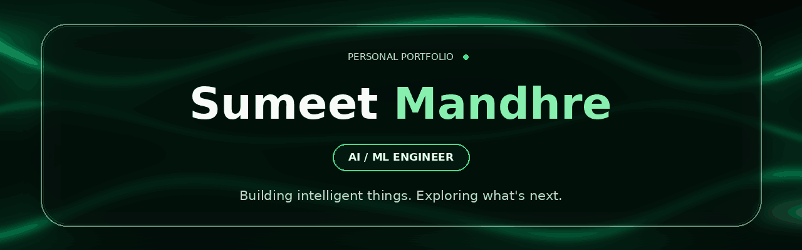

  

  

  
  
  

---

## About Me

I'm a Computer Engineering graduate interested in **Artificial Intelligence, Machine Learning and Data Science**.

I enjoy exploring data, building machine learning models and developing applications that turn technical ideas into practical solutions.

- Currently exploring AI/ML engineering and MLOps.
- Interested in machine learning, deep learning and data-driven applications.
- Always experimenting with new tools, technologies and ideas.

---

## Tech Stack

**Programming Languages**

  
  
  

**Machine Learning & Data Science**

  
  
  
  
  
  

**Data Engineering & MLOps**

  
  
  
  
  

**Development & Tools**

  
  
  
  
  
  
  

---

## Featured Projects

  <i>A few things I've been building and experimenting with.</i>

<table>
<tr>
<td width="50%" valign="top">

<h3 align="center">Herbal Plant Classifier</h3>

  
  

An image classification application that identifies 40 herbal plant categories using transfer learning.

- PyTorch and ResNet18
- Transfer learning
- Streamlit interface
- GitHub Actions automation

  

</td>
<td width="50%" valign="top">

<h3 align="center">Titanic — End-to-End ML Pipeline</h3>

  
  

An end-to-end machine learning project exploring the complete model development workflow.

- Data exploration and feature engineering
- Logistic Regression, Decision Tree and Random Forest
- Delta Lake and MLflow
- Streamlit application

  

</td>
</tr>
<tr>
<td width="50%" valign="top">

<h3 align="center">Uber Trip Analysis & Fare Prediction</h3>

  
  

A data analysis and fare prediction project using Uber trip data.

- Data analysis with Pandas
- Trip pattern exploration
- Random Forest regression
- Interactive Streamlit dashboard

  

</td>
<td width="50%" valign="top">

<h3 align="center">SQL Problem Solving</h3>

  
  

A collection of SQL practice problems and solutions focused on improving analytical thinking.

- Joins and subqueries
- CTEs and window functions
- Aggregations and filtering
- Query optimization practice

  

</td>
</tr>
</table>

---

## A Little More About Me

<b>What I'm currently interested in</b>

- Machine Learning and Deep Learning
- AI-powered applications
- Data Engineering and MLOps
- Model deployment and serving
- Building useful software products

<b>What I enjoy outside coding</b>

- Exploring new technologies
- Designing interfaces
- Gaming
- Learning and experimenting with creative tools

---

## Let's Connect

  
  

  <i>"Stay curious. Keep building. Make things that matter."</i>

  

